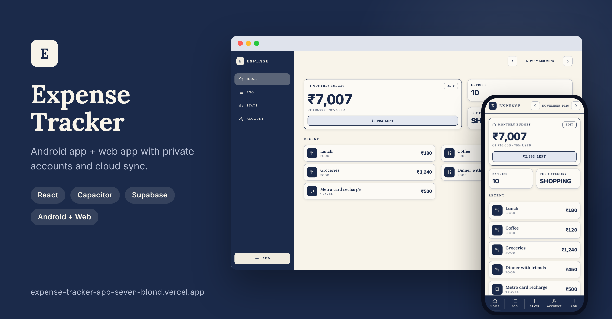
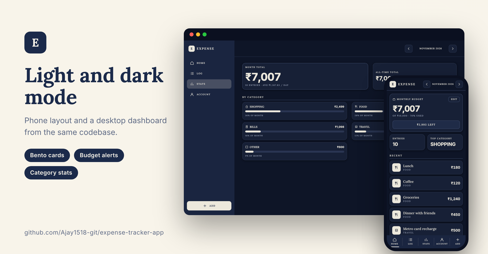

# Expense Tracker

A personal finance app that runs as an **Android app** and as a **website**, with private accounts and cloud sync. Log in on any device and your expenses are there.

**Live website:** https://expense-tracker-app-seven-blond.vercel.app/
**Android APK:** see the [latest release](../../releases/latest) (sideload; Android may show an "unknown app" warning)




## Features

- Add, edit, delete and **undo delete**; search expenses; future dates are blocked
- Total spending, **category-wise stats**, monthly summary, average per day, top category
- **Monthly budget** with status and alerts (warning from 80% used, over-budget and budget-reached messages)
- Email + password accounts; every user sees only their own data
- **Cloud sync** across phone and PC, and **data recovery** after uninstalling or changing phone
- Light and dark mode; phone layout with a bottom menu, desktop layout with a sidebar and bento cards

## Tech stack

React 18 · Vite · plain CSS (CSS variables) · Capacitor 6 (Android) · Supabase (Auth + Postgres + Row Level Security) · GitHub Actions · Vercel · lucide-react icons · Lora and Inter fonts

## How it works

- **Auth:** Supabase email and password, session kept on the device.
- **Data:** one JSON document per user in a `user_data` table. Row Level Security allows a user to read, insert and update only their own row; the anonymous role has no access. The service-role key is never used in the app.
- **Sync:** every expense carries a "last changed" time. Deletes are kept as markers. The app pulls the cloud copy, merges it item by item (newest change wins), and writes back only if the cloud is missing something, using a version check so a stale device cannot overwrite newer data. Each device keeps a per-user cache, so changes made while offline are kept and synced when you are back online (and whenever the app is opened).
- **Android:** `npm run build`, then Capacitor packages `dist/` into an Android project. A GitHub Actions workflow builds a **signed release APK** (private keystore kept in GitHub Secrets), numbers each build, and publishes it as a GitHub Release.
- **Web:** Vercel deploys every push to `main`.

## Run it yourself

```bash
npm install
npm run dev
```

1. Create a free Supabase project and put its URL and publishable key in `config.js`.
2. In the Supabase SQL editor, create the table and policies:

```sql
create table public.user_data (
  user_id uuid primary key default auth.uid() references auth.users(id) on delete cascade,
  data jsonb not null default '{}'::jsonb check (octet_length(data::text) < 5000000),
  version bigint not null default 1,
  updated_at timestamptz not null default now()
);
alter table public.user_data enable row level security;
revoke all on public.user_data from anon;
create policy "own select" on public.user_data for select to authenticated using (user_id = (select auth.uid()));
create policy "own insert" on public.user_data for insert to authenticated with check (user_id = (select auth.uid()));
create policy "own update" on public.user_data for update to authenticated using (user_id = (select auth.uid())) with check (user_id = (select auth.uid()));
grant select, insert, update on public.user_data to authenticated;
```

3. In Supabase, turn **Confirm email** off (the app has no email flow yet).

For the APK workflow, add these repository secrets: `KEYSTORE_BASE64`, `KEYSTORE_PASSWORD`, `KEY_ALIAS`, `KEY_PASSWORD`.

## Known limitations and next steps

- No email verification and no password reset yet
- Categories are fixed and there is one budget for all months
- Supabase free projects pause after a week of inactivity
- Planned: password reset, CSV export, per-month budgets

## History

The project started as a Python terminal app (`main.py`, JSON files, a 13-option menu). Those legacy files are still in the repository for reference.
